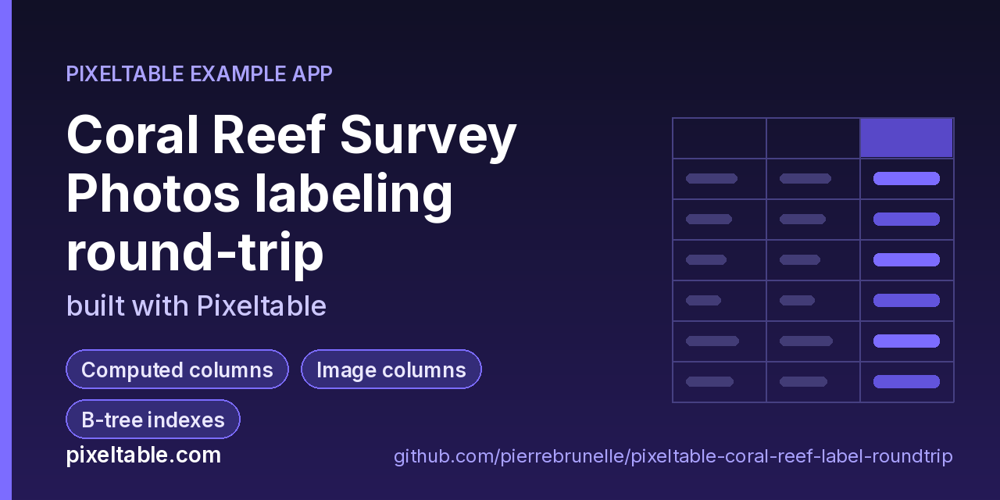

<!-- pixeltable-example-app: 20261104-coral-reef-label-roundtrip -->
# Run a segmentation label round trip with Label Studio in Python

**Short answer:** keep the photos, the model's labels and the human labels in one Pixeltable table. A computed column turns each photo's predictions into a Label Studio task (`predictions` = pre-annotations), so exporting the review batch is one query. When annotators finish, the Label Studio export goes back into the same rows with one `batch_update()`; computed columns convert it to pixel boxes, diff it against the model (kept / relabeled / added / removed, mean IoU) and recompute percent cover. The reviewed labels then export as a COCO dataset with `to_coco_dataset()` and as LanceDB training tiles with `export_lancedb()`. No sync scripts, no second store, and every step is versioned, so a bad import is one `revert()` away.

**Replaces:** Roboflow exports + Label Studio JSON scripts



[](https://codespaces.new/pierrebrunelle/pixeltable-coral-reef-label-roundtrip?quickstart=1)
[](https://pixeltable.com)
[](https://pypi.org/project/pixeltable/)
[](https://github.com/pixeltable/pixeltable)
[](LICENSE)

`Photos` holds one reef survey photo per row (`photo_id` primary key, site, depth, `image`, and dive metadata in a typed `pxt.Json[SurveyMeta]` column). Computed columns segment the photo into five reef classes (hard coral, soft coral, algae, rubble, bleached coral) with a small nearest-colour model in `udfs.py`, compute percent cover per class and build a Label Studio import task with the model's boxes as `predictions`. Two nullable columns, `reviewed_ls` and `annotator`, receive the Label Studio export; `reviewed`, `changes` and `reviewed_cover` are computed from them, so the label diff appears the moment a review lands. `Tiles` is a component view that cuts every photo into overlapping 256x192 tiles (`tile_iterator`) and lists the predicted and reviewed classes in each tile. The app was built in two schema versions: v1 without the review columns, then `pxt schema update` added them to the populated table without touching existing rows. `make_photos.py` renders six deterministic survey photos with known regions, so `pipeline.py verify` can check the whole round trip against the truth file.

[Pixeltable](https://pixeltable.com) is open-source, Python-native **multimodal AI data infrastructure**: tables, incremental computed columns, UDFs, indexes and serving in one library, running locally or on Pixeltable Cloud.

> ⭐ **Like this example?** Star [pixeltable/pixeltable](https://github.com/pixeltable/pixeltable) on GitHub. It helps other developers find it.

## What this example shows

- **Incremental computed columns** powered by plain Python UDFs (`@pxt.udf`)
- **B-tree indexes** declared on the model (`__indexes__`) back the lookup queries
- **Multimodal media columns** with configurable media destinations
- **Iterators**: one input row fans out into many (frames, chunks, sentences) via a view
- **Importable UDF module**: UDFs live in `udfs.py`; tables and queries live in `app.py` (Pixeltable resolves UDFs by module path)
- **`pixeltable.toml`** declares a local database and a **Pixeltable Cloud** database, so the same code deploys with `pxt db update`

## The round trip

| Step | Pixeltable |
|---|---|
| Model labels | computed column `predicted = segment_reef(image)` (a typed `Segmentation` TypedDict) |
| Label Studio task with pre-annotations | computed column `task = ls_task(...)`; export = `review_queue().collect()` |
| Re-import the review | `Photos.batch_update([{'photo_id': ..., 'reviewed_ls': annotation}, ...])` |
| Label diff | computed `changes = label_diff(predicted, reviewed)` |
| Training tiles | component view with `iterator=pxtf.image.tile_iterator(Photos.image, tile_size=(256, 192), overlap=(32, 32))` |
| COCO export | `Query.to_coco_dataset()` over `{'image': ..., 'annotations': coco_boxes(reviewed)}` |
| LanceDB export | `pxt.io.export_lancedb(query, uri, 'reef_tiles')` |

## Label Studio config

The tasks use `from_name='label'` and `to_name='image'`, so a project config like this one shows the pre-annotations:

```xml
<View>
  <Image name="image" value="$image"/>
  <RectangleLabels name="label" toName="image">
    <Label value="hard_coral"/><Label value="soft_coral"/><Label value="algae"/>
    <Label value="rubble"/><Label value="bleached_coral"/>
  </RectangleLabels>
</View>
```

Image paths in the tasks use Label Studio's local-files form (`/data/local-files/?d=reef/<file>`); point them at your storage (S3, GCS, a static server) for a real project.

## Notes

- The segmenter is deliberately simple (nearest colour + connected regions, regions under 600 px dropped), so the review has real work to do: it calls pinkish soft coral `hard_coral` and misses the small regions. Swap `segment_reef` for any model UDF; the rest of the round trip doesn't change.
- `survey` is a `pxt.Json[SurveyMeta]` column. Inserts still reject undeclared keys (`unexpected key: 'transect'`) and missing ones, while a path to an undeclared key, such as `Photos.survey.transect`, now resolves to `None` instead of raising.
- `batch_update()` raises `NotFoundError` for an unknown `photo_id` by default (`if_not_exists='error'`), which is what you want for a re-import: a review of a photo that isn't in the table should fail loudly.
- `export_lancedb` needs both `lancedb` and `pylance` installed (both are in requirements.txt).
- Changing the `Tiles` iterator (tile size or overlap) is reported as UNSUPPORTED by `pxt schema diff`; drop and recreate the view for a new tiling.
- `pipeline.py --target pxt://<your-org>:<your-db>` runs the same steps against a Pixeltable Cloud database. On a cloud target, `to_coco_dataset()` isn't available yet in 0.7.23, so run the `coco` step against a local catalog.

## What's inside

| File | What it is |
|------|------------|
| `.devcontainer/devcontainer.json` | GitHub Codespaces / Dev Container config: Python 3.12, installs `requirements.txt` |
| `.github/social-preview.png` | Social preview image (1280x640) |
| `CITATION.cff` | Citation metadata (authors, license, release date, keywords) |
| `app.py` | Tables declared as Python classes and `@pxt.query` functions |
| `data/reef-001.jpg` | Sample data |
| `data/reef-002.jpg` | Sample data |
| `data/reef-003.jpg` | Sample data |
| `data/reef-004.jpg` | Sample data |
| `data/reef-005.jpg` | Sample data |
| `data/reef-006.jpg` | Sample data |
| `data/truth.json` | Sample data |
| `make_photos.py` | Render small, deterministic coral-reef survey photos plus the ground-truth labels |
| `pipeline.py` | Drive the coral-reef label round trip: ingest -> Label Studio tasks -> review -> re-import -> diff -> export |
| `pixeltable.toml` | Project config: the local database plus a Pixeltable Cloud database (sizing, deploy excludes) |
| `udfs.py` | Pixeltable UDFs (`@pxt.udf`) in their own importable module, imported by `app.py` |
| `requirements.txt` / `pyproject.toml` | Dependencies (`pixeltable>=0.7.23`) |

**Tables**

| Table | Stored columns | Computed columns |
|-------|---------|------------------|
| `photos` | `photo_id`, `site`, `depth_m`, `file_name`, `image`, `survey`, `reviewed_ls`, `annotator` | `predicted`, `predicted_cover`, `task`, `reviewed`, `changes`, `reviewed_cover` |
| `tiles` | - | `predicted_labels`, `reviewed_labels` |
| `Region` | `label`, `bbox`, `area`, `score` | - |
| `Segmentation` | `model`, `regions` | - |
| `SurveyMeta` | `diver`, `visibility_m` | - |

## Run in your browser (GitHub Codespaces)

[](https://codespaces.new/pierrebrunelle/pixeltable-coral-reef-label-roundtrip?quickstart=1)

1. Click **Open in GitHub Codespaces** above (or [this link](https://codespaces.new/pierrebrunelle/pixeltable-coral-reef-label-roundtrip?quickstart=1)). The dev container installs Python 3.12 and `pixeltable>=0.7.23` from `requirements.txt`.
2. In the codespace terminal, create the tables, seed them and run the app:

   ```bash
   pxt schema update app.py reef
   python make_photos.py                  # render data/reef-*.jpg (6 photos) + data/truth.json with the known regions
   python pipeline.py ingest              # insert the photos: segmentation, cover, Label Studio tasks and tiles compute on insert
   python pipeline.py export              # unreviewed tasks -> output/ls_tasks.json (Label Studio import format)
   python pipeline.py annotate            # stand-in for the review: writes output/ls_export.json in Label Studio's export format
   python pipeline.py import report       # re-import the review, then what changed per photo and model vs reviewed cover
   python pipeline.py coco lancedb verify # COCO dataset + LanceDB tiles, then check every reviewed box against the truth
   ```


## Quickstart

Requires Python 3.11+ and `pixeltable>=0.7.23`.

```bash
git clone https://github.com/pierrebrunelle/pixeltable-coral-reef-label-roundtrip.git
cd pixeltable-coral-reef-label-roundtrip
python -m venv .venv && source .venv/bin/activate
pip install -r requirements.txt

# Create the tables in a local catalog directory named `reef`
pxt schema update app.py reef

python make_photos.py                  # render data/reef-*.jpg (6 photos) + data/truth.json with the known regions
python pipeline.py ingest              # insert the photos: segmentation, cover, Label Studio tasks and tiles compute on insert
python pipeline.py export              # unreviewed tasks -> output/ls_tasks.json (Label Studio import format)
python pipeline.py annotate            # stand-in for the review: writes output/ls_export.json in Label Studio's export format
python pipeline.py import report       # re-import the review, then what changed per photo and model vs reviewed cover
python pipeline.py coco lancedb verify # COCO dataset + LanceDB tiles, then check every reviewed box against the truth
```

## Deploy to Pixeltable Cloud

The same `app.py` runs on [Pixeltable Cloud](https://pixeltable.com). Sign in (or get a free trial database with `pxt new`), point the second database entry in `pixeltable.toml` at your own database, then deploy:

```bash
pxt login                       # or: export PIXELTABLE_API_KEY=<your-api-key>
# edit pixeltable.toml: name = 'pxt://<your-org>:<your-db>'
pxt db update pxt://<your-org>:<your-db>                 # build the image and upload the project
pxt schema update app.py pxt://<your-org>:<your-db>       # create the tables at the database root (no per-app folder)
```

Keep keys in environment variables or `pxt secret set`, never in code.

## Code walkthrough

**1. Business logic is plain Python, in `udfs.py`.** A `@pxt.udf` function can be used as a column expression. Pixeltable records UDFs by module path (`udfs.segment_reef`), so they live in their own importable module rather than inline in the app: the daemon, serving workers and Pixeltable Cloud import it again by that path.

```python
# udfs.py
@pxt.udf
def segment_reef(image: PIL.Image.Image) -> Segmentation:
    """Nearest-colour segmentation into the reef classes, one box per connected region."""
    small = image.convert('RGB').resize((image.width // SCALE, image.height // SCALE), PIL.Image.BILINEAR)
    arr = np.asarray(small, dtype=np.float32)
    dist = ((arr[:, :, None, :] - PALETTE[None, None, :, :]) ** 2).sum(-1)
    cls = dist.argmin(-1)
    regions: list[Region] = []
    for i, label in enumerate(LABELS):
        for x0, y0, x1, y1, n in _components(cls == i):
            area = n * SCALE * SCALE
            if area < MIN_AREA:
                continue
            box = [x0 * SCALE, y0 * SCALE, (x1 - x0 + 1) * SCALE, (y1 - y0 + 1) * SCALE]
            fill = n / ((x1 - x0 + 1) * (y1 - y0 + 1))
            regions.append({'label': label, 'bbox': box, 'area': area, 'score': round(min(1.0, fill), 3)})
    regions.sort(key=lambda r: (r['bbox'][1], r['bbox'][0]))
    return {'model': MODEL_VERSION, 'regions': regions}
```

**2. Tables are Python classes (`app.py`).** Annotated attributes are stored columns; attributes assigned an expression are **computed columns** (`predicted`, `predicted_cover`, `task`, `reviewed`, `changes`, `reviewed_cover`), evaluated incrementally on every insert or update and recomputed when their inputs change. Indexes live next to the columns.

```python
# app.py
class Photos(TableModel, name='photos'):
    """One reef survey photo, the model's labels and (after review) the annotator's labels."""

    photo_id = pxt.Column(type=pxt.String, primary_key=True)
    site: pxt.String
    depth_m: pxt.Float
    file_name: pxt.String
    image: pxt.Image
    survey: pxt.Json[SurveyMeta]

    width = image.width
    height = image.height
    predicted = segment_reef(image)
    predicted_cover = cover_pct(predicted, width, height)
    task = ls_task(photo_id, file_name, site, predicted, width, height)

    # filled by the Label Studio re-import (pipeline.py import)
    reviewed_ls: pxt.Json | None
    annotator: pxt.String | None
    reviewed = ls_to_segmentation(reviewed_ls)
    changes = label_diff(predicted, reviewed)
    reviewed_cover = cover_pct(reviewed, width, height)

    __indexes__ = [pxt.BtreeIndex(site)]
```

## FAQ

**How do I send model predictions to Label Studio as pre-annotations?**

Make the task a computed column. `task = ls_task(photo_id, file_name, site, predicted, width, height)` returns Label Studio's import format with the model's boxes under `predictions[0].result` (`rectanglelabels`, coordinates in percent). `pipeline.py export` writes every unreviewed task to `output/ls_tasks.json`, which you import into a Label Studio project with a matching `RectangleLabels` config.

**How do I bring the reviewed Label Studio annotations back?**

Read Label Studio's JSON export and call `Photos.batch_update()` keyed on `photo_id`, writing each task's `annotations[0]` into `reviewed_ls`. The computed columns `reviewed`, `changes` and `reviewed_cover` are filled in the same call, and the `Tiles` view picks up the reviewed classes too.

**Can I see what the annotators changed?**

Yes. `changes` is a computed column that matches model boxes to reviewed boxes by IoU and reports kept, relabeled (e.g. `hard_coral->soft_coral`), added and removed boxes plus the mean IoU. `pipeline.py report` prints it per photo, next to the model vs reviewed percent cover.

**Can I add review columns to a table that already has data?**

Yes. Declare them in the model (`reviewed_ls: pxt.Json | None`, plus computed columns over it) and run `pxt schema update app.py reef`. The diff marks every addition as safe; existing rows get nulls and the computed columns stay null until a review arrives. Dropping or renaming columns is flagged DESTRUCTIVE and needs `--allow-destructive`.

**How do I export the reviewed labels for training?**

`pipeline.py coco` selects `{'image': Photos.image, 'annotations': coco_boxes(Photos.reviewed)}` and calls `to_coco_dataset()`. `pipeline.py lancedb` exports the `Tiles` view (tile image, box and classes) with `pxt.io.export_lancedb()`.

**Does this replace Roboflow exports and custom Label Studio scripts?**

For the data side, yes: tasks, predictions, reviewed labels, diffs and exports all live in one table, and every change is versioned (`history()`, `revert()`). Label Studio stays the labeling UI; Pixeltable replaces the glue scripts and the folders of exported JSON.

## Learn more

- 🌐 Website: https://pixeltable.com
- 📚 Docs: https://docs.pixeltable.com
- 💻 Source: https://github.com/pixeltable/pixeltable (⭐ star it if Pixeltable is useful to you)
- 📦 PyPI: https://pypi.org/project/pixeltable/
- 🧩 More example apps: https://pierrebrunelle.github.io/awesome-pixeltable-apps/

**[More Pixeltable example apps →](https://pierrebrunelle.github.io/awesome-pixeltable-apps/)**

---

<sub>Built as part of a daily series of Pixeltable example apps · Pixeltable 0.7.23 · Python, incremental computed columns · Licensed under Apache-2.0.</sub>
